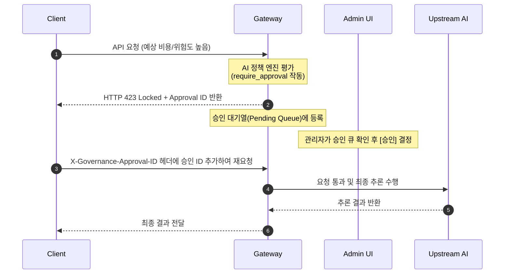

# AI Proxy Gateway - 안전 및 보안 거버넌스 운영 가이드 (Safety & Governance Operations Guide)

본 가이드는 AI Proxy Gateway 어드민 대시보드의 **안전(Safety)** 탭에서 제공하는 핵심 보안 통제 기능들의 아키텍처, 작동 매커니즘, 상세 설정 규격 및 API 활용법을 설명합니다. 본 시스템은 전사 AI 트래픽의 안전성을 확보하고 비즈니스/재무 리스크를 선제적으로 통제하기 위한 다차원 보안 기능을 탑재하고 있습니다.

---

## 목차
1. [긴급 정지 (Kill Switch)](#1-긴급-정지-kill-switch)
2. [비용 가드 및 예측 (Cost Guard & Predictor)](#2-비용-가드-및-예측-cost-guard--predictor)
3. [AI 정책 엔진 (AI Policy Engine)](#3-ai-정책-엔진-ai-policy-engine)
4. [민감 정보 방화벽 (Secret Firewall)](#4-민감-정보-방화벽-secret-firewall)
5. [승인 워크플로우 (Approval Workflow)](#5-승인-워크플로우-approval-workflow)
6. [AI 장애 감지 (AI Incident Monitor)](#6-ai-장애-감지-ai-incident-monitor)
7. [지능형 실시간 알림 규칙 (Alert Rules)](#7-지능형-실시간-알림-규칙-alert-rules)
8. [데이터 유출 방지 (DLP)](#8-데이터-유출-방지-dlp)

---

## 1. 긴급 정지 (Kill Switch)

중대한 보안 침해 사고(예: 전사적 프롬프트 인젝션 공격, 대규모 민감 데이터 유출 등)나 인프라 위급 상황이 발생했을 때, **1초 이내에 게이트웨이를 통과하는 모든 AI 호출 트래픽을 즉시 차단**하는 비상 장치입니다.

### 1.1 작동 메커니즘
- **즉각 차단**: 스위치가 활성화되면 모든 `/v1/...` 경로에 대한 API 호출이 백엔드 업스트림으로 전달되지 않고 즉시 차단됩니다.
- **반환 규격**:
  - **HTTP Status Code**: `503 Service Unavailable`
  - **Response Header**: `Retry-After: 60`, `X-Kill-Switch: global`
  - **Response Body**: 차단 사유(Reason)를 담은 에러 메시지 반환
- **추적성 보장**: 스위치 상태 변경 시 변경자(ID), 변경 사유(Reason), 변경 시각이 감사 로그(`audit_events`) 및 시스템 DB에 기록됩니다.

### 1.2 API 활용 예제
```bash
# 1. 킬스위치 즉시 작동 (전체 차단)
curl -X POST http://localhost:8080/admin/kill-switch \
  -H "Authorization: Bearer $ADMIN_TOKEN" \
  -H "Content-Type: application/json" \
  -d '{"disabled": true, "reason": "긴급 내부 보안 점검으로 인한 임시 서비스 차단"}'

# 2. 서비스 운영 재개 (정상화)
curl -X POST http://localhost:8080/admin/kill-switch \
  -H "Authorization: Bearer $ADMIN_TOKEN" \
  -H "Content-Type: application/json" \
  -d '{"disabled": false}'
```

---

## 2. 비용 가드 및 예측 (Cost Guard & Predictor)

통제 불가능한 대규모 API 호출로 인한 **재무적 손실(Cost Spike)을 방지**하기 위한 가드레일 장치입니다.

### 2.1 예산 한도 통제 (Cost Guard)
- **임계값 제어**: 안전 탭에서 지정한 임계값(KRW 단위)을 초과하는 요청이 발생할 경우 트랜잭션을 사전 차단합니다.
- **차단 규격**:
  - **HTTP Status Code**: `402 Payment Required`
  - **헤더 우회 지원**: 긴급한 작업의 경우, 클라이언트가 HTTP 헤더에 `X-Cost-Approve: 1`을 실어 보내면 통제 규칙을 일시 우회하여 통과를 허용합니다. (해당 우회 이력은 별도 감사 로그로 집계됨)
- **실시간 통계 제공**: 모든 중계 응답의 HTTP 헤더에 실시간 비용 메트릭을 동적으로 주입합니다:
  - `X-Estimated-Input-Tokens` / `X-Estimated-Output-Tokens`
  - `X-Estimated-Cost-KRW` / `X-Estimated-Latency-MS`

### 2.2 비용 예측 엔진 (Cost Predictor)
- **동적 예측 원리**: 입력 토큰 수와 `max_tokens` 설정을 기반으로 응답 요금을 사전에 연산합니다. 출력 토큰 예측 시, 지정된 모델의 **최근 7일간 평균 출력 토큰량**을 기본 통계 표본으로 적용하여 단순 단가 곱셈보다 정교한 청구 요금을 예측합니다. (데이터 부족 시 기본 600토큰으로 수렴)
- **UI 연동**: 안전 탭 하단의 "비용 예측" 계산기를 통해 모델명, 입력 토큰 수, max_tokens를 입력하여 실시간 가상 요금 및 지연 시간을 즉시 계산해볼 수 있습니다.

---

## 3. AI 정책 엔진 (AI Policy Engine)

사내 규정 준수 및 보안 등급 관리를 위한 **동적 룰 평가 엔진(Governance Rule Engine)**입니다. 

### 3.1 룰 평가 우선순위
- 정책 리스트의 **우선순위(Priority, 1~999)** 값을 기준으로 정렬되어 순차적으로 평가됩니다. **우선순위 숫자가 낮을수록** 먼저 검사됩니다.
- 여러 정책이 동시에 매칭되면 최종 동작은 `BLOCK > APPROVAL > ALLOW > DEFAULT` 순서로 결정됩니다. 예를 들어 한 rule이 `require_approval` 을 만들고 다른 rule이 `block` 을 만들면 HTTP 403 차단이 승인을 이깁니다.
- 매칭된 판단은 `policy_decision_events` 에 남습니다. 차단/승인뿐 아니라 허용 판단(`allow`, `allow_model`, `allow_provider`)도 감사 추적을 위해 기록됩니다.
- 매칭 규칙이 없는 정상 허용 경로도 `decision=default` 로 기록됩니다. XView·Trace Links·요청 상세의 실질 거버넌스 카운트(`policy_decision_count`)는 `default`를 제외하고, 원시 감사 이벤트 수는 `policy_decision_total` 로 확인합니다.

### 3.2 9대 정책 조건 (Conditions)
정책 규칙 생성 시 매핑할 수 있는 조건 항목 명세입니다:

| 조건명 (Condition) | 조건값 예시 | 설명 |
| :--- | :--- | :--- |
| `contains_secret` | `true` / `false` | 민감 정보(Secret) 발견 여부 |
| `risk_score` | `>80`, `>=50` | AI Risk Analyzer가 분석한 위험도 점수 |
| `complexity_score` | `>85`, `>=60` | 프롬프트 및 코드 밀도 기반 0~100 복잡도 점수 |
| `cost_krw` | `>1000` | 요청 1건당 예상 환산 비용(원) |
| `team` | `platform` | 호출 사용자의 소속 팀 ID 또는 팀명 매핑 |
| `role` | `developer`, `viewer` | 사용자의 권한 등급 |
| `model` | `gpt-*`, `claude-3-5*` | 클라이언트가 호출한 LLM 모델 (와일드카드 패턴 지원) |
| `provider` | `openai`, `anthropic` | 최종 라우팅될 타겟 업스트림 프로바이더 |
| `mcp_tool` | `execute_bash` | 호출에 사용된 MCP 도구명 |

### 3.3 8대 제어 조치 (Actions)
조건 충족 시 실행할 액션 지정 명세입니다:

- **`block`**: 요청을 즉시 반려하고 에러 반환.
- **`require_approval`**: 런타임에 트래픽을 일시 유보하고 **승인 큐(Approval Queue)**로 전달.
- **`secret_mask`**: 민감한 시크릿 정보가 포함되었을 경우, 해당 부분만 `[MASKED_...`로 마스킹 후 업스트림 전달.
- **`secret_block`**: 민감 정보 포함 시 즉시 트랜잭션 전면 차단.
- **`deny_models`**: 특정 모델 리스트에 대한 호출 권한을 박탈 (액션값에 모델명 명시).
- **`allow_models`**: 허용된 모델 리스트 외의 모든 모델 호출 차단.
- **`deny_providers`** / **`allow_providers`**: 특정 업스트림 공급자 대상 라우팅 통제.
- **`allow`**: 명시적 허용 판단을 감사 로그에 남김. 단, 같은 요청에서 `block` 이 매칭되면 차단이 우선합니다.

### 3.4 정책 예제

```yaml
- name: block-secret-leak
  contains_secret: true
  block: true

- name: approve-high-risk
  risk_score: ">80"
  require_approval: true

- name: security-team-model-allowlist
  team: security
  allow_models:
    - gpt-5
    - claude-sonnet
```

동시에 매칭되는 경우 `block-secret-leak` 가 최종 동작을 결정합니다. `approve-high-risk` 와 `security-team-model-allowlist` 의 판단도 감사 이벤트에 남아 사후 설명과 증빙에 사용할 수 있습니다.

---

## 4. 민감 정보 방화벽 (Secret Firewall)

사내 소스코드 및 대화 트래픽 내에 **API Key, 패스워드, 인증 토큰 등이 포함되어 외부 LLM에 유출되는 것을 실시간 스캔하고 제어**하는 지능형 보안 장치입니다.

### 4.1 탐지 대상 시크릿 유형
- 사내/외 API Keys (Github Token, OpenAI Key, Slack Webhook 등)
- DB 접속 커넥션 스트링 (JDBC, PostgreSQL DSN 등)
- 비대칭 키 및 SSH Private Keys
- JWT (JSON Web Tokens) 및 OAuth Access Tokens
- 텍스트 내 포함된 패스워드 및 크레덴셜 정보

### 4.2 스캔 제어 액션
1. **Detect (탐지)**: 트래픽은 그대로 통과시키되, 탐지 내역을 감사 로그(`secret_events`)에 상세 기록하여 보안 관제 모니터링을 지원합니다.
2. **Mask (마스킹)**: 보안이 침해된 데이터 영역을 감지하여 `[MASKED_API_KEY]` 등의 가공 문자열로 치환하여 모델에 전송합니다. 개발 도구(Cursor 등)의 연속적인 작업을 방해하지 않으면서 자산을 보호합니다.
3. **Block (차단)**: 민감 정보 감지 시 즉시 전송을 무효화하고 HTTP `403 Forbidden` 에러를 반환합니다.

> v0.86.183부터 민감 정보 방화벽은 DLP의 **자격 증명·비밀** 프로필이 아는 형식(Anthropic·Google·Stripe·Cloudflare·Hugging Face·npm·GitLab 토큰, Azure 저장소 키, Discord 웹훅 등)도 함께 탐지합니다. 기존 규칙의 이름과 보고 형식은 그대로입니다. 개인정보·금융·의료 정보까지 정책별로 다루려면 [8. 데이터 유출 방지 (DLP)](#8-데이터-유출-방지-dlp)를 쓰세요.

---

## 5. 승인 워크플로우 (Approval Workflow)

비용이 크거나 위험도가 높은 에이전트 작업을 수행하기 전, **보안 관리자의 승인을 거쳐 트래픽을 통과시키는 휴먼-인-더-루프(Human-in-the-Loop) 시스템**입니다.



### 5.1 운영 방법
- **대기열 조회**: 관리자는 안전 탭의 **승인 큐**에서 상태가 `pending`인 승인 건의 상세 내용(사용자, 사유, 위험도, 요금 등)을 확인합니다.
- **결정**: 관리자가 심사 후 `Approve`(승인) 또는 `Reject`(거절)을 결정하면, 대기 중이던 클라이언트 재요청이 인증 단계를 무사히 통과하게 됩니다.

---

## 6. AI 장애 감지 (AI Incident Monitor)

다중 업스트림 환경에서 특정 AI 공급자(OpenAI, Anthropic 등)의 **네트워크 장애, 5xx 서브시스템 다운 타임을 실시간 추적하고 시각화**하는 모니터링 모듈입니다.

- **장애 판정 기준**: 프로바이더별 **자동 전환(Fallback) 또는 5xx 오류**가 **시간당 5건 이상** 발생할 경우 시스템은 이를 인시던트로 규정하고 대시보드에 적재합니다.
- **영향 범위 가시성**: 해당 장애로 인해 우회 경로로 대피한 횟수(폴백 횟수) 및 이로 인해 작업 중단 위기를 모면한 **실제 사용자 수(명)**를 집계하여 정량적인 인프라 복원력을 입증합니다.

---

## 7. 지능형 실시간 알림 규칙 (Alert Rules)

이상 트래픽, 비용 폭주, 에이전트 오동작(무한 루프) 등을 실시간 감시하여 **슬랙(Slack) 등의 Webhook으로 관리자에게 긴급 푸시하는 경보 규칙 엔진**입니다.

### 7.1 핵심 알림 지표 (14종)
안전 탭의 알림 규칙 생성기에서 제공하는 핵심 감시 지표 규격입니다:

- **`requests`**: 지정된 시간 내 총 API 요청 수 급증 감시.
- **`errors`**: 5xx 에러 및 라우팅 오류 발생률 (0.00 ~ 1.00 범위).
- **`krw`**: 시간 윈도우 내 발생한 누적 원화 비용 급증 감시.
- **`tokens`**: 소모 토큰 수 급등 감시.
- **`latency_p95_ms`** / **`first_chunk_p95_ms`**: 인프라 병목 탐지용 전체/첫 번째 토큰 지연 시간 P95 지표.
- **`llm_eval_failures`** / **`llm_eval_failure_rate`**: 답변 품질 자동 검증 실패 건수 및 실패율 감시.
- **`tool_errors`** / **`tool_error_rate`**: 에이전트가 실행한 도구(Tool) 호출 실패 수 및 실패율.
- **`tool_loop`**: **에이전트 도구 루프 감지 지표.** 하나의 작업 세션 내에서 특정 도구가 반복 호출된 최대 횟수를 측정하여 무한 루프로 인한 요금 낭비를 사전 방지.
- **`mcp_new_tools`**: **MCP 신규 도구 감지 (드리프트).** 시스템에 등록되지 않았던 새로운 MCP 툴이 유입되는 횟수를 감지하여 권한 통제.
- **`anomaly_zmax`**: 비용/트래픽 빈도 통계 분석 기반 이상 징후 Z-Score 최댓값 감시.
- **`budget_burn_ratio`**: **예산 소진 가속도 감시.** 현재 요금 소모 속도 기준, 월말에 도달했을 때 *월말 누적 예상액 / 배정된 월 예산* 비율을 계산하여 한도 도달 전 미리 통보 (`1.0` 초과 시 월말 예산 초과를 의미).

---

## 8. 데이터 유출 방지 (DLP)

프롬프트와 모델 응답에서 **개인정보·금융정보·정부 식별번호·의료 정보·자격 증명**을 찾아, 정책에 따라 기록하거나(FLAG) 가리거나(MASK) 막습니다(BLOCK). Cloudflare AI Gateway의 [DLP](https://developers.cloudflare.com/ai-gateway/features/dlp/)와 같은 모델(프로필 → 정책 → 동작, `cf-aig-dlp` 헤더, 오류 문구)을 따르고, 국내 운영에 필요한 부분을 더했습니다.

콘솔: **비용 및 보안 → 데이터 유출 방지** (`/app/dlp`). 읽기는 `security:read`, 저장은 `admin:write` 권한이 필요합니다.

### 8.1 Cloudflare DLP와 다른 점

| 항목 | Cloudflare AI Gateway | 이 게이트웨이 |
| --- | --- | --- |
| 동작 | Flag, Block | Flag, **Mask**, Block — 마스킹은 찾은 값만 `[REDACTED_…]`로 바꾸고 나머지는 그대로 보냅니다 |
| 캐시 적중 | DLP를 건너뜀 | 캐시된 응답도 **현재 정책으로 다시 검사**하고, 마스킹·차단 대상이면 캐시를 쓰지 않고 공급자에게 보냅니다 |
| 정책 적용 범위 | 게이트웨이 전체 | 정책마다 **팀·API 키**로 좁힐 수 있습니다(둘 다 지정하면 둘 다 맞아야 적용) |
| 국내 형식 | — | 주민·외국인등록번호(검증 숫자), 사업자등록번호, 운전면허·여권 번호, 휴대·유선 전화, 도로명 주소, 국내 계좌, 건강보험증 번호 |
| 증거 보관 | 탐지 기록 | 찾은 값은 **원문으로 어디에도 저장하지 않습니다** — 부분 미리보기(`k•••@e•••.com (21자)`, 숫자는 끝 두 자리만 `•••61 (14자)`)와 지문(`GATEWAY_SECRET`에서 만든 키로 계산한 HMAC-SHA-256 앞 16자리), 또는 지문만 |

### 8.2 프로필

| 프로필 ID | 이름 | 탐지 항목 (기본 신뢰도 기준) |
| --- | --- | --- |
| `credentials` | 자격 증명·비밀 | PEM 개인 키, JWT, OpenAI·Anthropic·Google·AWS·GitHub·GitLab·Slack·Stripe·Cloudflare·Hugging Face·npm 키·토큰, Slack·Discord 웹훅, Azure 저장소 키, DB 연결 문자열, `password=`·`api_key=`·`Bearer` 값 |
| `financial` | 금융 정보 | 카드 번호(브랜드 범위 + Luhn), 국내 계좌(문맥 필요), IBAN(mod-97), 미국 라우팅 번호(문맥 필요) |
| `government` | 정부 식별번호 | 주민·외국인등록번호(날짜·성별 자리 검사, 검증 숫자 일치 시 높음), 사업자등록번호(검증 숫자), 운전면허·여권 번호, 미국 SSN·ITIN |
| `pii` | 개인 식별 정보 | 이메일, 휴대·유선·국제 전화번호, 도로명 주소, 생년월일(문맥 필요), 공인 IP(사설·예약 대역 제외) |
| `health` | 의료 정보 | 건강보험증 번호, 환자·의무기록 번호, 진단 코드(ICD-10/KCD) — 모두 문맥 단어가 있을 때만 |
| `pii_record` | 개인정보 레코드 | 서로 다른 개인정보 **3종 이상이 400바이트 안에 함께** 나올 때만 — 한 사람의 정보 묶음 |

- **신뢰도**: 형식만 맞으면 낮음·보통, 검증 숫자가 맞거나 문맥 단어(예: `계좌`, `주민`, `진단`)가 가까이 있으면 한 단계 올라갑니다. 문맥이 필요한 항목은 문맥 없이 숫자만으로는 잡지 않습니다.
- **조정**: 프로필마다 최소 신뢰도와 최소 일치 개수를 바꾸고, 오탐이 잦은 항목은 끌 수 있습니다.
- **오탐 방지**: 같은 위치를 두 항목이 읽으면 한 번만 셉니다. URL 로그인 부분(`postgres://app:pw@db`)의 `pw@db`는 이메일로 보지 않습니다(연결 문자열로 잡힙니다).
- **사용자 정의 프로필**: 정규식 또는 키워드 목록으로 회사 고유 정보(프로젝트 코드명, 사번 형식 등)를 정의합니다. 정규식은 Go RE2 문법이라 역참조가 없고 실행 시간이 입력 길이에 비례합니다.

### 8.3 정책과 동작

정책은 `{동작, 프로필 목록, 검사 대상(요청/응답), 팀, API 키}`입니다. 켜진 정책을 **모두** 평가하고, 걸린 정책 중 **가장 강한 동작**(차단 > 마스킹 > 기록)을 적용합니다.

| 동작 | 요청에서 | 응답에서 |
| --- | --- | --- |
| 기록 `FLAG` | 그대로 보내고 이벤트만 남김 | 그대로 전달하고 이벤트만 남김 |
| 마스킹 `MASK` | 찾은 값을 `[REDACTED_…]`로 바꾼 요청을 보냄. 라우팅·캐시·로그도 마스킹된 요청 기준 | 찾은 값을 바꾼 응답을 전달. 스트리밍은 이벤트 경계·`[DONE]`을 지키고, 여러 이벤트에 걸쳐 나뉜 값도 통째로 바꿈. 바꾼 뒤에도 남아 있으면 차단으로 올림 |
| 차단 `BLOCK` | `400` `dlp_request_blocked` — "Request content blocked due to DLP policy violations" | `400` `dlp_response_blocked` — "Response content blocked due to DLP policy violations". 차단된 응답은 캐시에 넣지 않음 |

마스킹한 응답에서는 `logprobs`를 `null`로 바꿉니다(토큰 하나하나가 원래 값을 다시 보여 주기 때문입니다). 마스킹한 뒤 다시 검사해 가릴 값이 남아 있으면 응답을 차단합니다. 일반 텍스트 응답도 같은 방식으로 가립니다.

권장 정책(콘솔의 **권장 정책 추가**): 자격 증명은 마스킹, 정부 식별번호가 든 요청은 차단, 그 밖의 개인·금융·의료 정보는 요청과 응답 모두 기록. 새 정책은 **기록으로 시작**해 탐지 이벤트에서 오탐을 확인한 뒤 마스킹이나 차단으로 올리세요.

### 8.4 검사 범위와 비용

- **대상**: `/v1/` 아래 POST 요청 본문(JSON이면 문자열 값만, 아니면 본문 전체)과 응답(공급자의 오류 응답도 프롬프트를 인용할 수 있어 함께 검사). 임베딩 응답은 벡터라 검사하지 않습니다. 에이전트 경로·MCP 탐색이 도구 결과를 담아 공급자에게 다시 보내는 요청에도 요청 정책을 적용합니다(차단이면 실행을 멈춥니다).
- **검사 상한**(`max_scan_bytes`, 기본 1MiB, 1KiB~8MiB): 상한을 넘으면 `oversize` 설정에 따라 **통과**하거나 **차단**합니다. 통과일 때는 **뒷부분부터** 상한만큼 검사합니다 — 대화의 최신 메시지와 답변의 끝이 새 내용이고, 앞부분은 보통 운영자가 쓴 시스템 프롬프트이기 때문입니다. 응답은 32MiB까지 버퍼링하며, 그보다 크면 통과 설정에서는 검사 없이 전달하고 `X-Vibe-DLP-Response: skipped_oversize`를 붙입니다.
- **읽을 수 없는 형식**: 압축된 요청 본문(`Content-Encoding`)은 요청 검사 정책이 있으면 `415 dlp_encoded_body`로 거절합니다. 응답은 gzip을 풀어 검사하고, br·zstd처럼 풀 수 없는 응답은 상한 초과와 같이 다룹니다(차단 또는 `X-Vibe-DLP-Response: skipped_encoding`).
- **도구 입력**: 도구 호출의 `input`·`arguments`·`args`와 `metadata` 안에서는 키 이름(`id`, `type` 등)과 상관없이 모든 문자열을 검사합니다. 바깥 봉투의 `model`·`role`·`id` 같은 식별자만 건너뜁니다.
- **게이트웨이가 직접 답하는 모델**: Text2SQL(`vibe/text2sql-*`, DB 조회 결과가 답에 들어감), MCP 탐색, 에이전트 경로도 공급자 응답과 똑같이 검사하고, 요청 로그에 DLP 이벤트와 가림을 적용합니다. 응답 검사 정책이 걸리면 이 모델들의 스트리밍 답도 실행이 끝날 때까지 모았다가 보냅니다.
- **응답을 끝까지 받지 못했을 때**(공급자나 클라이언트 연결 끊김): DLP 차단이 아니라 `502 upstream_read_failed`로 답하고 DLP 이벤트를 남기지 않습니다.
- **스트리밍**: 응답 검사 정책이 하나라도 걸리면 스트림을 끝까지 받은 뒤 검사하고 보냅니다(Cloudflare와 같은 방식). 조각은 클라이언트가 이어 붙이는 단위대로 — 선택지(`n` > 1)별, 본문·추론(`reasoning_content`)·도구 인자별, 콘텐츠 블록별로 — 이어 붙여 읽으므로, 값이 여러 이벤트로 나뉘거나 다른 선택지와 섞여 와도 찾습니다. 첫 토큰이 늦어지므로 응답 검사는 필요한 팀·키로 좁히세요. 요청만 검사하면 스트리밍에 영향이 없습니다.
- **오래 걸리는 스트림 연결 유지**: 응답을 모으는 동안 10초가 지나도록 끝나지 않으면, 상태(200)와 스트림 헤더(`X-Vibe-DLP-Stream: held`, `X-Request-ID`)를 먼저 보내고 10초마다 SSE 주석 줄(`: vibe-dlp: …`, 클라이언트는 무시)을 보내 클라이언트·프록시의 유휴 시간 제한에 끊기지 않게 합니다. 이 경우 DLP 결과는 트레일러(`X-Vibe-DLP`·`cf-aig-dlp`·`X-Vibe-DLP-Response`)로 오고, 차단은 스트림 안의 오류 이벤트로 알립니다 — Chat Completions는 `data: {"error":{"code":"dlp_response_blocked",…}}` 다음 `data: [DONE]`, `/v1/messages`는 Anthropic `event: error`, `/v1/responses`는 `event: error`. SDK는 모두 API 오류로 올립니다. 게이트웨이가 직접 답하는 모델(Text2SQL처럼 JSON으로 답하는 경우 포함)도 스트림을 요청했으면 같은 방식으로 이어지고, JSON 답은 스트림 조각으로, 오류는 오류 이벤트로 바꿔 보냅니다. 앞단 프록시가 트레일러를 지우면(nginx 기본값) 결과 헤더 대신 탐지 이벤트에서 확인하세요. 10초 안에 끝나는 답은 지금처럼 일반 헤더와 `400`을 씁니다.
- **나중에 덧붙는 내용**: 지식 베이스 확장(`{{kb:…}}`·`X-Vibe-Knowledge`)과 `X-Vibe-Context`처럼 DLP 단계 뒤에 요청 본문이 바뀌면, 공급자로 보내기 직전에 바뀐 본문을 다시 검사합니다. 처음 검사에서 이미 찾은 값은 다시 세지 않습니다.
- **나뉜 값**: 요청의 문자열은 하나씩 읽고, 한 메시지의 콘텐츠 파트들과 **같은 역할의 연속 메시지**(긴 붙여넣기를 여러 사용자 메시지로 나눠 보내는 경우)는 이어 붙여서도 읽습니다. 이어 읽기에서는 **경계에 걸친 값**(`900101-` + `1234561`)만 더합니다 — 시스템 프롬프트와 사용자 메시지처럼 역할이 다른 텍스트는 잇지 않고, 한쪽의 문맥 단어로 다른 쪽 숫자를 판정하지 않아 조각마다 깨끗한 요청을 막지 않습니다. 마스킹은 값이 시작하는 조각에 표시를 두고 나머지 조각을 지우며, 요청 로그에도 나뉜 값의 조각을 남기지 않습니다. 응답 스트림은 `content_block_start`에 실린 텍스트도 이어지는 `delta`와 함께 읽습니다.
- **다시 보내는 값**: 에이전트가 다음 턴에 대화와 도구 결과를 다시 보내거나 지식 베이스가 이미 가린 값을 되풀이해도, 마스킹·차단은 매번 다시 적용합니다. 이벤트와 지표만 처음 찾은 값을 다시 세지 않습니다.
- **반영 시간**: 저장한 설정은 각 게이트웨이가 5초 안에 다시 읽습니다. 저장된 설정을 읽지 못하면 마지막으로 정상이던 설정을 계속 씁니다.

### 8.5 응답 헤더

정책이 하나라도 걸리면 같은 JSON을 두 헤더에 붙입니다. `cf-aig-dlp`는 Cloudflare와 같은 형식이라 기존 클라이언트 코드를 그대로 쓸 수 있습니다.

```http
X-Vibe-DLP: {"findings":[{"profile":{"context":{},"entry_ids":["kr_rrn"],"profile_id":"government"},"policy_ids":["block-government-ids"],"check":"REQUEST"}],"action":"BLOCK"}
cf-aig-dlp: (같은 값)
```

### 8.6 탐지 이벤트와 로그

- 걸린 프로필마다 `dlp_events`에 한 줄: 검사 대상, 동작, 정책, 프로필, 항목, 일치 수, 최고 신뢰도, 팀·키·모델, 증거. 요청 로그와 같은 보존 기간으로 함께 지워집니다.
- 증거는 `partial`(부분 미리보기 최대 5개 + 지문 최대 10개) 또는 `hash_only`(지문만). 지문으로 같은 값이 반복해서 새는지 원문 없이 비교할 수 있습니다. `GATEWAY_SECRET`이 개발용 기본값이면 키가 공개된 셈이라 지문을 남기지 않고 부분 미리보기만 남깁니다. 지문은 `GATEWAY_SECRET`에서 만든 키로 계산하므로, 전화번호·주민번호처럼 경우의 수가 적은 값도 키 없이는 모든 후보를 대입해 되찾을 수 없습니다. `GATEWAY_SECRET`을 바꾸면 그 뒤 지문은 이전 지문과 비교되지 않습니다.
- 동작과 상관없이(기록만 해도) 걸린 프로필이 찾는 값은 **요청 로그의 프롬프트, 콘솔에 보이는 본문 요약, 원본 본문(`LOG_RAW_BODIES`), 응답 텍스트(`LOG_RESPONSE_TEXT`)에서도 가려서** 저장합니다. 요청에서 찾은 값을 모델이 답에서 되풀이해도 가립니다. 가리는 중에 오류가 나면 해당 텍스트는 저장하지 않습니다. 정책 요약(`policy_summary`)에는 `dlp` 항목이 붙고, 차단된 요청의 오류 코드는 `dlp_request_blocked`/`dlp_response_blocked`입니다.
- 지표: `/metrics`의 `proxy_dlp_decisions_total{check="request|response",action="flag|mask|block"}`.

### 8.7 관리 API

| 메서드·경로 | 권한 | 설명 |
| --- | --- | --- |
| `GET /admin/security/dlp` | `security:read` | 설정, 버전(`revision`), 프로필 카탈로그, 권장 정책 |
| `PUT /admin/security/dlp` | `admin:write` | 설정 저장. 본문 `{config, expected_revision, reason}`. 다른 사람이 먼저 저장했으면 `409 dlp_conflict`, 설정 오류는 `422 dlp_config_invalid`와 항목별 `issues[{path, message}]`. 감사 로그에 남습니다 |
| `POST /admin/security/dlp/test` | `security:read` (초안은 `admin:write`) | 텍스트를 저장된 설정 또는 보낸 초안(`config`)으로 검사. 초안은 사용자 정의 패턴을 많이 담을 수 있어 저장 권한이 있는 사람만 보낼 수 있습니다(`403 dlp_draft_forbidden`). 팀·키 범위(`team_id`, `api_key_id`)를 줄 수 있고, 결과에는 위치·판정·마스킹된 요청·헤더 값이 나옵니다. 검사한 텍스트는 저장하지 않습니다 |
| `GET /admin/security/dlp/events` | `security:read` | 탐지 이벤트와 동작·대상·프로필·날짜별 요약. `hours`(최대 2160), `action`, `check`, `profile`, `request_id`, `team_id`, `limit`. 팀 범위 관리자는 자기 팀 이벤트만 봅니다 |

```bash
# 저장 전 초안으로 검사해 보기 (텍스트는 가상 예시)
curl -s -X POST "$GATEWAY/admin/security/dlp/test" \
  -H "Authorization: Bearer $ADMIN_TOKEN" -H "Content-Type: application/json" \
  -d '{"text":"주민번호 900101-1234561, 연락처 010-1234-5678"}' | jq '.request.action, .header'
```

### 8.8 콘솔 조작

- **저장 전 확인**: 화면 아래 저장 막대에 저장하면 바뀔 내용이 요약됩니다(예: `변경 2건: DLP 켜기 · 정책 추가: 자격 증명은 가리고 보내기`). 저장하지 않은 채 다른 메뉴로 가거나 탭을 닫으면 먼저 묻습니다. 같은 화면 안의 탭·필터 이동은 초안을 그대로 둡니다.
- **단축키**: `Ctrl+S`(macOS `⌘+S`) 저장, 테스트 스캔 입력란에서 `Ctrl+Enter` 검사.
- **프로필**: `탐지 항목 찾기`로 이름·ID·설명·문맥 단어를 검색하고, 항목마다 **시험**을 누르면 그 가상 예시로 테스트 스캔이 바로 열려 검사됩니다.
- **테스트 스캔**: 입력 크기를 검사 상한과 함께 보여 주고(넘으면 실제 요청에서 어떻게 되는지 표시), **지우기**로 입력과 결과를 비웁니다. 응답 헤더는 한 줄 요약으로 보여 주고 JSON은 펼쳐 봅니다. 저장 권한이 없으면 저장된 설정으로 검사합니다.
- **탐지 이벤트**: 동작별·프로필별 요약 막대를 누르면 그 값으로 걸러지고, 다시 누르거나 **필터 초기화**로 풉니다. 필터는 주소에 남아 그대로 공유할 수 있습니다.

### 8.9 운영 순서

1. **권장 정책 추가** → **테스트 스캔**에서 가상 예시나 실제와 비슷한 문장으로 판정을 확인합니다(저장 전 초안 기준).
2. DLP를 켜고 저장합니다. 처음에는 기록 위주로 며칠 운영합니다.
3. **탐지 이벤트**에서 프로필·항목별 오탐을 확인하고, 프로필의 최소 신뢰도·일치 개수를 올리거나 항목을 끕니다.
4. 오탐이 충분히 줄면 해당 정책을 마스킹이나 차단으로 올립니다. 응답 검사는 지연이 생기므로 필요한 팀·키로 좁힙니다.
